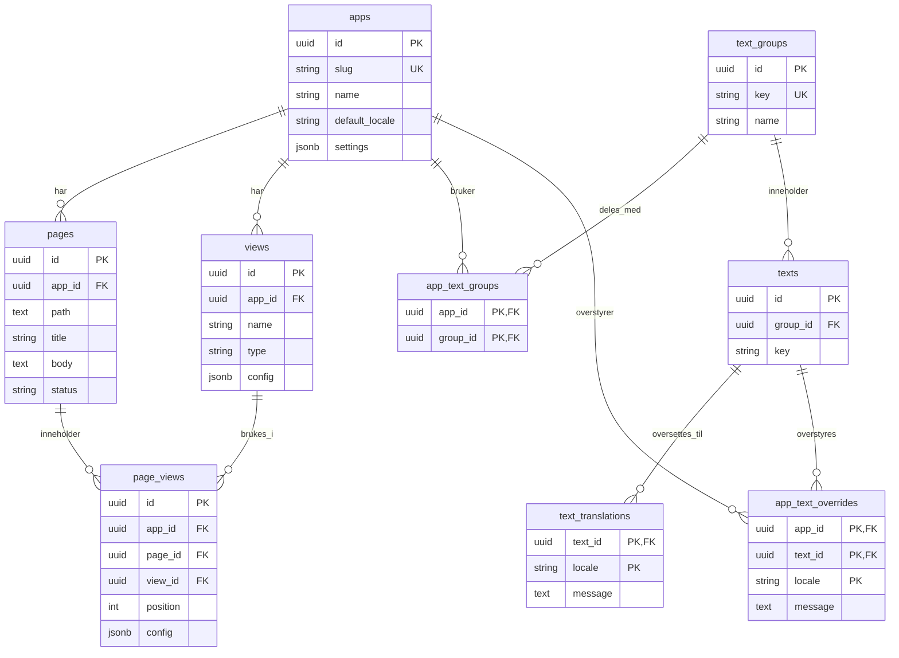

# Datamodell

Skjemaet innføres i migrering `202611140002_apps_views_and_translations.js`. Den første migreringen endres ikke, slik at eksisterende databaser kan oppgraderes med `npm run db:migrate`.



Entitetene og oversettelsene har `created_at`/`updated_at`. PostgreSQL oppdaterer endringstidspunkt automatisk. Koblingstabellen `app_text_groups` har bare nøklene.

## Apper, sider og visninger

- `apps.slug` er appens offentlige identifikator. `default_locale` er `nb` som standard.
- `pages` har unik `(app_id, path)`. `/`, `/tilbud` og `/hjelp/kontakt` er gyldige stier. Bruk små bokstaver, tall og bindestrek i stisegmenter. Status er `draft` eller `published`.
- En visning tilhører én app og kan brukes flere ganger på én eller flere sider. `type` identifiserer komponenten som frontend skal rendre.
- `page_views` har unik `(page_id, position)`, med posisjon fra 0. Sammensatte fremmednøkler håndhever at side og visning tilhører samme app.
- `config`/`settings` må være JSON-objekter. API-et returnerer visningens `view_config` og plasseringens `page_config` separat. Frontend bestemmer hvordan komponentens innstillinger kombineres.

`pages.title` er intern metadata. `body` beholdes for å bevare eksisterende innhold og støtte det gamle API-et. Oversettbare tekster refereres gjennom stabile nøkler i visningskonfigurasjonen, eksempelvis `{ "title": "checkout.submit" }`.

## Tekster og språk

`text_groups.key` er globalt unik. `texts.key` er unik innenfor gruppen. Nøklene starter med liten bokstav og kan inneholde små bokstaver, tall og understrek. `checkout.submit` betyr gruppe `checkout`, tekst `submit`.

En app må kobles til gruppen i `app_text_groups` før tekstene kan hentes gjennom appens API. Fellesverdier ligger i `text_translations`. Appen kan lagre sin egen fullstendige melding i `app_text_overrides`, også for språk som mangler i fellesoversettelsene. En overstyring brukes bare når appen er koblet til tekstgruppen.

Begge meldingstabellene har `message NOT NULL`. Tom streng er en gyldig overstyring. Tilbakestilling sletter overstyringsraden; da brukes fellesverdien igjen.

Språk lagres som kanoniske BCP 47-koder, eksempelvis `nb`, `nn`, `en-GB` og `zh-Hant`. Backend normaliserer forespørsler med `Intl.Locale` og fjerner locale-utvidelser før oppslag. Ved innlegging av data må språk normaliseres tilsvarende; PostgreSQL sjekker taggens grunnform, mens runtime validerer BCP 47.

Fallback for `en-GB` med standardspråk `nb` er `en-GB → en → nb`. For `zh-Hant-HK` prøves `zh-Hant-HK → zh-Hant → zh`, deretter appens standardspråk og dets foreldre. For **hvert språk** prøves appens overstyring før fellesoversettelsen. En felles engelsk oversettelse får derfor prioritet over en norsk overstyring når engelsk etterspørres.

Hver returnert tekst oppgir faktisk språk og om verdien er overstyrt. Hvis alle språk mangler, returneres `{ "locale": null, "message": null, "isOverride": false }`; formateringsendepunktet gir HTTP 404.

## ICU og flertall

`message` støtter ICU MessageFormat gjennom FormatJS, med språkets CLDR-regler:

```text
{count, plural,
  =0 {Ingen meldinger}
  one {# melding}
  other {# meldinger}
}
```

`=0` er eksakt treff. `one`/`other` er språklige kategorier, og språk som arabisk støtter også `zero`, `two`, `few` og `many`. `other` er obligatorisk. Hele meldingen overstyres samlet per app/språk.

`createMessageFormatter` validerer ICU-syntaks ved opprettelse. Formatering av tall, antall og tidspunkt krever endelige JSON-tall; dato/tid oppgis som millisekunder siden Unix epoch. Manglende eller ugyldige variabler gir HTTP 400. Ugyldig lagret ICU gir HTTP 500 og logges på serveren. Et fremtidig skrive-/publiserings-API må bruke samme validering før lagring og kontrollere parameterkontrakten mellom oversettelser.

Meldinger og variabler behandles som tekst. HTML-lignende innhold blir ikke tolket som riktekst av formatteren. Frontend skal rendre resultatet som tekst, eksempelvis vanlig React-innhold.

## API-eksempler

Endepunktene leser offentlig innhold. De endrer ikke databasen. Utkast og manglende sider gir HTTP 404. Appavgrensning er ikke en innloggings- eller tilgangskontrollmekanisme.

```bash
curl 'http://localhost:3000/api/apps/shop/pages?path=/tilbud'
curl 'http://localhost:3000/api/apps/shop/texts/checkout?locale=en-GB'
curl -X POST \
  'http://localhost:3000/api/apps/shop/texts/checkout/messages/format?locale=nb' \
  -H 'Content-Type: application/json' \
  -d '{"variables":{"count":2}}'
```

Eksempelrespons fra tekstgruppe-oppslag:

```json
{
  "app": "shop",
  "group": "checkout",
  "locales": ["en-GB", "en", "nb"],
  "texts": {
    "submit": { "locale": "en", "message": "Pay now", "isOverride": false }
  }
}
```

## Oppgradering og rollback

Migrering 002 oppretter appen `default`, flytter eksisterende sider dit og konverterer `slug` til `path` med innledende `/`. ID, innhold, status og tidsstempler bevares. Det gamle `/api/pages/:slug`-endepunktet leser bare fra denne appen.

Rollback gjenoppretter det gamle skjemaet når dataene kan representeres der. Den avvises hvis flere apper, visninger, tekstgrupper eller sidestier som ikke passer det gamle slug-formatet er lagt til. Dermed slettes ikke ny CMS-data ved et uhell. Knex kjører migreringene i transaksjoner.
