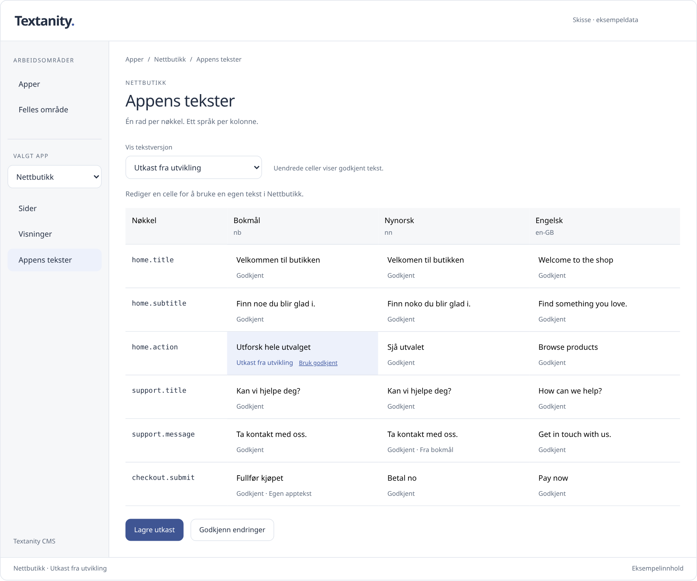
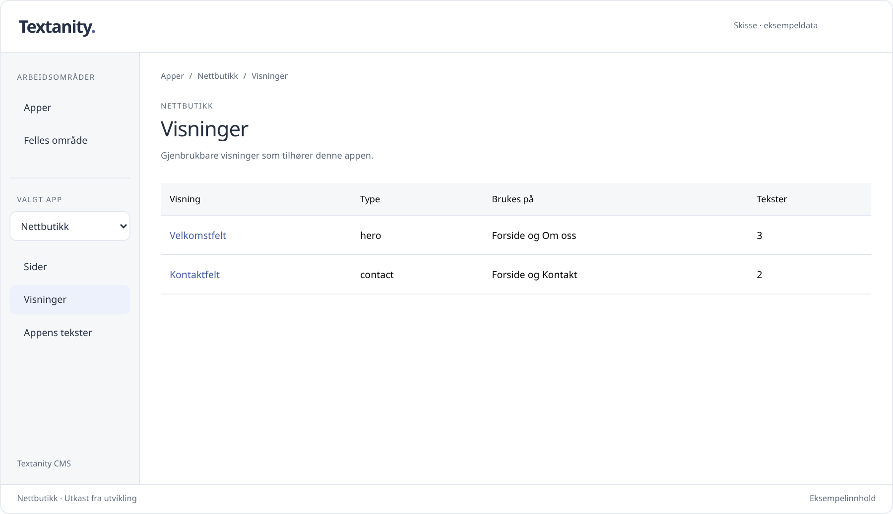

# Textanity – GUI-skisser

Forslag til navigasjon: **app → side → visning**, med et eget **fellesområde** for delte tekstgrupper og oversettelser. Alt innhold er eksempeldata.

[Åpne PDF med alle sju skissene](textanity-skisser.pdf)

## Arbeidsområder

Alle undersider bruker tabeller: sidelister, visningsoversikt, sidens visninger, sideinformasjon, innstillinger og tekster. Startsiden beholder inngangene til apper og fellesområdet.

Teksttabellene har kolonnene **Nøkkel | Bokmål | Nynorsk | Engelsk**. Tekstene redigeres direkte i cellene.

## Appens sider

## Side og visninger

## Visningseditor

## Felles område

## Appens tekster

## Visningsoversikt

## Tekstversjoner og statuser

Velg **Godkjent**, **Utkast fra utvikling**, **Utkast fra fag** eller **Utkast fra oversettelse** over teksttabellen. Utkastene er separate. Oppslag skjer per nøkkel og språk: hvis valgt utkast ikke har en endring, vises den godkjente teksten. Et utkast arver aldri et annet utkast.

Cellene viser hvilken versjon verdien kommer fra. **Bruk godkjent** fjerner cellens utkastendring. Tom tekst kan være en eksplisitt endring. Godkjent-visningen er skrivebeskyttet.

**Godkjenn endringer** godkjenner bare endringene i den synlige tabellen og valgt utkast. Andre utkast beholdes. Apputkast gjelder den valgte appen; fellesutkast ligger i fellesområdet. Alt er eksempeldata og handlingene skjer bare i skissen.

## Klikkbar versjon

Den selvstendige, klikkbare prototypen ligger i `index.html`. `galleri.html` viser alle bildene, og `textanity-skisser.pdf` samler dem som PDF. Prototypen bruker bare eksempeldata; ingen endringer sendes til CMS-et.

[Åpne den klikkbare skissen på GitHub Pages](https://haakonph.github.io/Textanity/gui-skisser/).

Pages publiserer fra `gh-pages`. Filene er testet som en selvstendig nettside.
