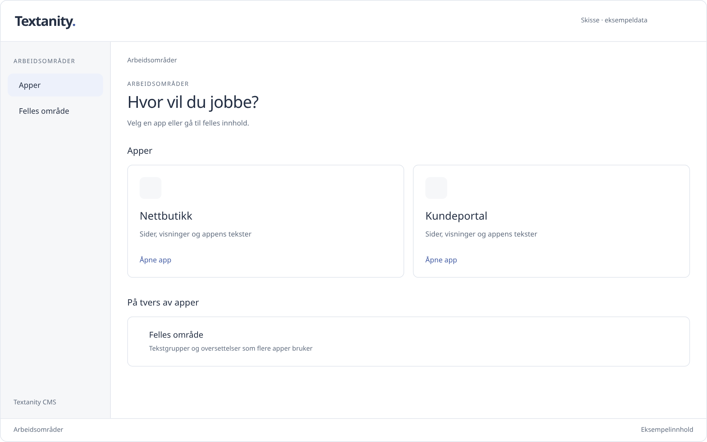
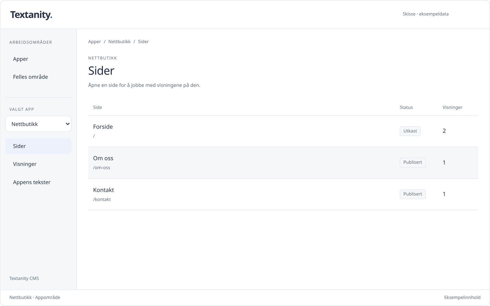
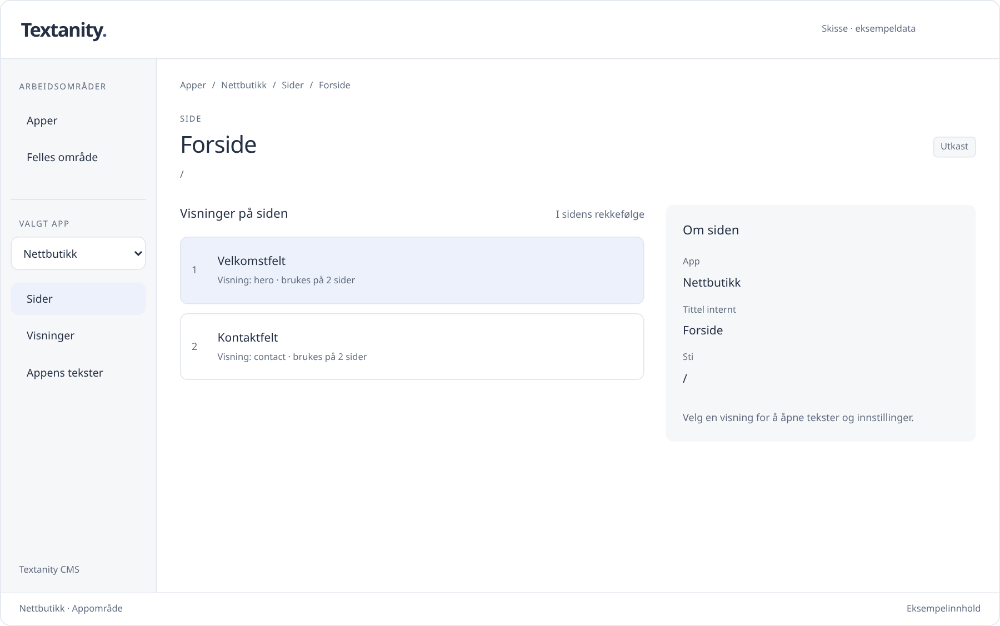
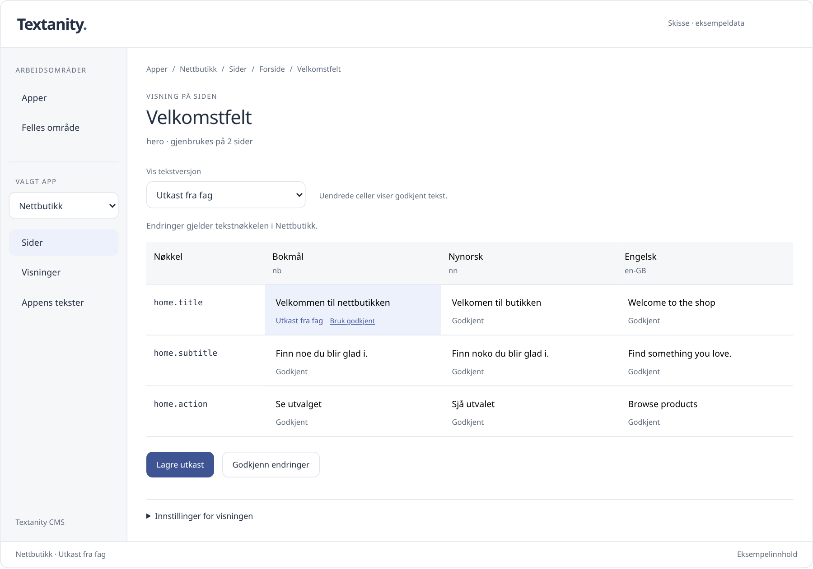
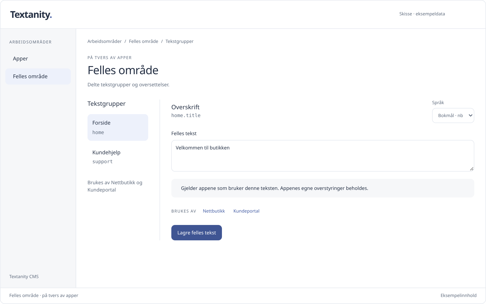

# Textanity – GUI-skisser

Forslag til navigasjon: **app → side → visning**, med et eget **fellesområde** for delte tekstgrupper og oversettelser. Alt innhold er eksempeldata.

[Åpne PDF med alle fem skissene](textanity-skisser.pdf)

## Arbeidsområder

## Appens sider

## Side og visninger

## Visningseditor

## Felles område

## Klikkbar versjon

Den selvstendige, klikkbare prototypen ligger i `index.html`. `galleri.html` viser alle bildene, og `textanity-skisser.pdf` samler dem som PDF. Prototypen bruker bare eksempeldata; ingen endringer sendes til CMS-et.

GitHub Pages må aktiveres én gang av en bruker med tilgang til Pages-innstillingene:

1. Åpne [Settings → Pages](https://github.com/haakonph/Textanity/settings/pages).
2. Velg **Deploy from a branch**, grenen **gh-pages**, mappen **/ (root)** og **Save**.
3. Når utrullingen er ferdig, åpne https://haakonph.github.io/Textanity/gui-skisser/.

Publiseringskoblingen fikk HTTP 403 ved forsøk på å aktivere Pages. Filene er lastet opp og testet som selvstendig nettside.
